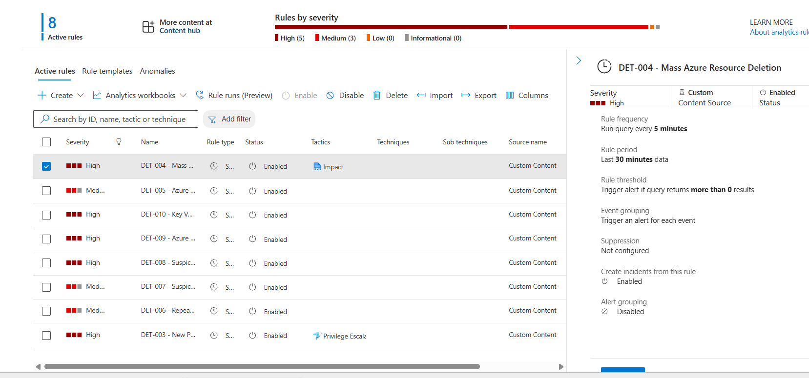
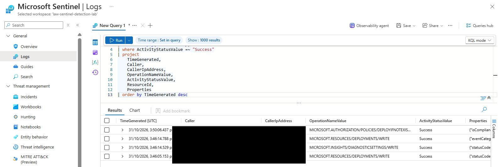
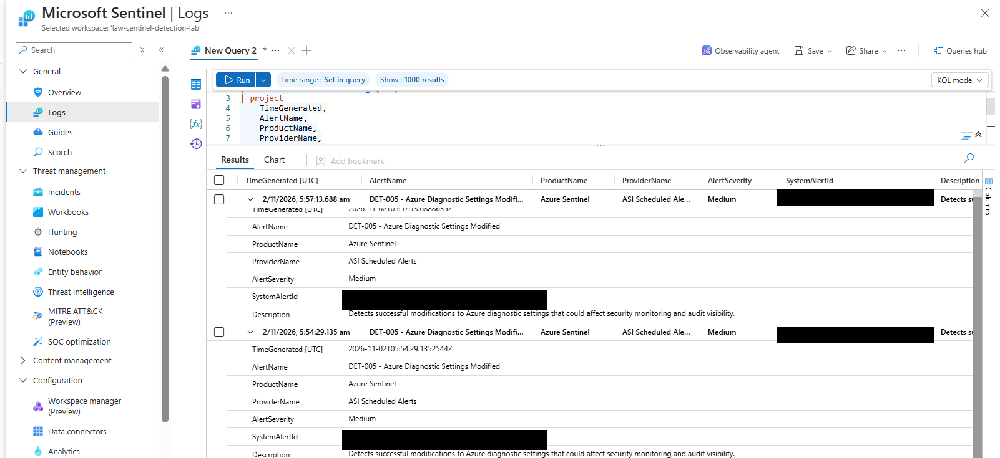

# Sentinel Detection Engineering Lab — Evidence Register

## 1. Purpose

This directory contains selected supporting evidence for the Microsoft Sentinel Detection Engineering Lab. It records the Azure Activity ingestion, scheduled analytics-rule configuration, KQL validation, real DET-005 detection, and alert/incident investigation.

Evidence is explicitly classified as **real Azure/Sentinel activity** or **synthetic query-local testing**. Synthetic tests must not be represented as real Azure events, Sentinel alerts, or incidents.

## 2. Evidence collection scope

| Item | Details |
|---|---|
| Platform | Microsoft Azure and Microsoft Sentinel |
| Log source | Azure Activity |
| Log Analytics table | `AzureActivity` |
| Workspace | `law-sentinel-detection-lab` |
| Evidence period | 31 October – 2 November 2026 |
| Analytics rules | DET-003 through DET-010 |
| Investigation queries | 7 |
| Incident reports | 3 |

## 3. Verified evidence register

| Evidence | Observation | Status |
|---|---|---|
| Azure Activity ingestion | `AzureActivity` records successfully queried | Verified |
| Analytics rules | Eight scheduled analytics rules created and enabled | Verified |
| DET-005 source event | One successful diagnostic-settings modification observed | Verified |
| DET-005 alert generation | Two alert records generated from the same underlying source event | Verified |
| DET-005 incident generation | Two incidents correlated with the two alert records; both relate to the same source event | Verified |
| Other detection rules | Real alert/incident generation not demonstrated | Not demonstrated |
| Synthetic RBAC test | Query-local test returned the expected result | Verified as simulation only |
| Synthetic deletion test | Query-local rolling-window test returned the expected result | Verified as simulation only |
| DET-007 synthetic validation | Positive detection, policy exclusion, and rolling-window boundary tests passed | Verified as simulation only |
| DET-008 synthetic validation | Three expected test rows returned | Verified as simulation only |
| DET-009 synthetic validation | Two expected test rows returned | Verified as simulation only |
| DET-010 synthetic validation | Two expected test rows returned | Verified as simulation only |
| Investigation query pack | Seven KQL investigation queries created | Verified |

## 4. Selected screenshot evidence

The screenshots below are selected from the supplied Azure/Sentinel capture archive. Sensitive values have been masked in the two data-bearing screenshots. The original unredacted captures are not included in this evidence package.

### 4.1 Eight enabled analytics rules

**What this supports:** The Sentinel analytics-rules view shows eight active rules, with DET-003 through DET-010 listed as enabled.

**Evidence classification:** Real Azure/Sentinel configuration.

### 4.2 Real Azure Activity diagnostic-settings event

**What this supports:** The Azure Activity query results include a successful `MICROSOFT.INSIGHTS/DIAGNOSTICSETTINGS/WRITE` operation in the observed period. Caller identity and IP fields are masked.

**Evidence classification:** Real Azure Activity telemetry.

### 4.3 Two DET-005 alert records

**What this supports:** The Sentinel alert query shows two DET-005 alert records. Alert identifiers are masked.

**Evidence classification:** Real Sentinel alert records.

**Interpretation:** These two alert records are associated with the same underlying Azure Activity source event. They do not represent two independently verified diagnostic-settings modifications.

> The two incident records are documented in the incident report and validation results. This screenshot demonstrates the two alert records, not the incident list itself.

## 5. Real detection evidence — DET-005

**Detection rule:** DET-005 — Azure Diagnostic Settings Modified

Azure Activity recorded a successful subscription-level diagnostic-settings write operation.

| Attribute | Observed value |
|---|---|
| Operation | `MICROSOFT.INSIGHTS/DIAGNOSTICSETTINGS/WRITE` |
| Activity status | Success |
| Event category | Administrative |
| Detection rule | DET-005 |
| Severity | Medium |
| Underlying source events | 1 |
| Alert records | 2 |
| Incident records | 2 |
| Incident status at evidence collection | New |

The available evidence confirms the source event and detection pipeline. Both alert records and both incidents relate to the same underlying event. They must not be described as separate security events.

The investigation remains open. Authorization, intent, root cause, and the reason for duplicate incident creation remain undetermined. A successful administrative operation alone does not establish malicious activity.

## 6. Synthetic detection validation

Synthetic tests used query-local data to validate detection logic. They do not represent real Azure Activity events or real Sentinel alert/incident generation.

| Detection/test area | Result | Classification |
|---|---|---|
| RBAC detection logic | Expected result returned | Synthetic |
| Mass resource deletion | Rolling-window test passed | Synthetic |
| Suspicious resource creation | Positive, exclusion, and boundary tests passed | Synthetic |
| NSG modification | Three expected rows returned | Synthetic |
| Policy assignment modification | Two expected rows returned | Synthetic |
| Key Vault configuration modification | Two expected rows returned | Synthetic |

The absence of qualifying real events during the reviewed period does not prove a detection is ineffective. It means real-world alert generation for those rules was not demonstrated during the observation window.

## 7. Investigation and playbook status

Seven KQL investigation queries were created. The DET-005 investigation correlated two alert records with two incidents associated with the same source event.

A Logic App named `la-sentinel-incident-response` and a Sentinel automation rule were configured. However, the supplied run-history screenshots show failed workflow executions, and the incident-comment action returned HTTP 400 BadRequest.

Therefore:
- Playbook configuration was attempted.
- Successful end-to-end playbook execution was not demonstrated.
- Successful incident-comment insertion was not demonstrated.
- Automated containment or remediation was not demonstrated.

The playbook is an incomplete improvement item and must not be presented as a successfully operating response automation.

## 8. Evidence limitations and interpretation

1. A successful Azure administrative operation is not automatically malicious.
2. Synthetic KQL output validates query logic only.
3. A query match does not automatically prove alert or incident generation.
4. Two alert records and two incidents associated with one source event do not establish two independent security events.
5. No real alert/incident generation is claimed for DET-003, DET-004, or DET-006 through DET-010 unless separately demonstrated by evidence.
6. A configured playbook does not establish successful automation.
7. No automated containment or destructive response has been demonstrated.

## 9. Public evidence hygiene

This repository is intended for public portfolio and interview demonstration. Do not publish credentials, tokens, secrets, connection strings, personal account details, unnecessary subscription or tenant identifiers, caller object IDs, personal IP addresses, or raw Sentinel alert identifiers.

The screenshots in this package have been selectively redacted. Keep original operational captures private. Redaction in this package is limited to masking sensitive fields; it does not change the underlying query results.

## 10. Final evidence checklist

| Requirement | Status |
|---|---|
| Azure Activity ingestion | Verified |
| Eight enabled analytics rules | Verified |
| DET-005 real source event | Verified |
| DET-005 two alert records | Verified |
| DET-005 two correlated incidents | Verified in incident documentation |
| Synthetic KQL validation | Verified |
| Seven investigation queries | Verified |
| Incident report documented and redacted | Verified |
| Analytics-rules screenshot | Included |
| Redacted Azure Activity screenshot | Included |
| Redacted DET-005 alert screenshot | Included |
| Screenshot of incident list | Not included in supplied capture selection |
| Successful Logic App playbook execution | Not demonstrated |
| Automated containment | Not demonstrated |

## 11. Project conclusion

The lab demonstrates a Microsoft Sentinel detection-engineering workflow covering Azure Activity ingestion, scheduled analytics rules, KQL detection logic, synthetic validation, real DET-005 alert generation, incident correlation, and investigation documentation.

The strongest real-world demonstration is DET-005: a successful Azure diagnostic-settings modification was detected and generated two alert records and two correlated incidents from one underlying source event.

The project deliberately distinguishes verified operational evidence from synthetic validation and incomplete automation. This makes the evidence suitable for technical review without overstating the lab's demonstrated capabilities.
